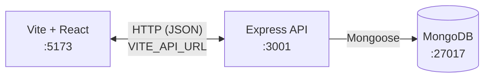

# Finance Dashboard

A multi-route **finance workspace** with a dark, editorial "terminal meets product design" look: charcoal surfaces, amber accents, **DM Serif Display** for headlines and key figures, and **JetBrains Mono** for data and labels. The **Vite + React** frontend talks to a **Node.js + Express + MongoDB** API. When the API is unavailable or the user is not signed in, pages fall back to embedded mock data for demos.

### Highlights

- JWT authentication with protected REST endpoints
- Interactive charts for portfolio performance, allocation and market sparklines
- Integration tests with Jest + Supertest across auth, portfolio, transactions and markets
- One-command setup with Docker Compose (React + Express + MongoDB)
- Graceful fallback to mock data when the API is offline

## Architecture



- **Frontend:** React Router, Tailwind v4, Recharts, Axios (`src/api/`)
- **Backend:** JWT auth, REST routes under `/api`, seed script for demo data

## Tech Stack

### Frontend

- [React](https://react.dev/) + [TypeScript](https://www.typescriptlang.org/)
- [Vite](https://vite.dev/) for development and builds
- [React Router](https://reactrouter.com/) (`react-router-dom`)
- [Tailwind CSS](https://tailwindcss.com/) (v4 + Vite plugin)
- [Recharts](https://recharts.org/) for charts
- [Axios](https://axios-http.com/) for API calls

### Backend (`/server`)

- Node.js 20, Express 5, TypeScript
- MongoDB via Mongoose
- JWT (`jsonwebtoken`) + `bcryptjs`
- Jest + Supertest for integration tests
- Docker multi-stage image (port **3001**)

## Routes (Frontend)

| Path | Page |
|------|------|
| `/` | **Overview**: KPIs, portfolio chart, allocation, recent activity |
| `/portfolio` | **Portfolio**: summary, P&L by holding, holdings table |
| `/markets` | **Markets**: asset grid, filters, sort, sparklines |
| `/transactions` | **Transactions**: ledger, pagination, filters |
| `/settings` | **Settings**: profile and preferences (UI) |
| `/login` | **Login**: email/password, JWT stored for API calls |

Unknown paths under the main layout redirect to `/`.

## Run with Docker

From the repository root:

```bash
docker compose up --build
```

- **MongoDB:** `localhost:27017`
- **API:** `http://localhost:3001`
- **Client (Vite dev):** `http://localhost:5173` (with `VITE_API_URL` pointing at the API)

The API service waits for MongoDB. Seed the database if you need demo data (see below).

## Run Locally (without Docker)

### 1. MongoDB

Run MongoDB 7 locally on port `27017` (or set `MONGODB_URI` accordingly).

### 2. API (`/server`)

```bash
cd server
cp .env.example .env   # edit JWT_SECRET, MONGODB_URI if needed
npm install
npm run dev            # http://localhost:3001
```

Optional seed (demo user `demo@apex.com` / `demo1234`):

```bash
npm run seed
```

### 3. Frontend (repository root)

```bash
cp .env.example .env   # set VITE_API_URL=http://localhost:3001
npm install
npm run dev            # http://localhost:5173
```

Sign in at `/login`, or set `VITE_AUTO_LOGIN_DEMO=true` in `.env` (with the API running and seeded) for automatic demo login.

### Production Build (Frontend)

```bash
npm run build
npm run preview
```

## REST API

Base URL: `http://localhost:3001`. All bodies are JSON. Protected routes require the header `Authorization: Bearer <token>`.

| Method | Path | Description |
|--------|------|-------------|
| POST | `/api/auth/register` | Register `{ email, password, name }`, returns JWT |
| POST | `/api/auth/login` | Login `{ email, password }`, returns JWT |
| GET | `/api/auth/me` | Current user (protected) |
| GET | `/api/portfolio/summary` | Totals: invested, current value, return (protected) |
| GET | `/api/portfolio/holdings` | All holdings for the user (protected) |
| GET | `/api/portfolio/history` | ~12-month portfolio value series (protected) |
| GET | `/api/transactions` | Paginated list; query: `page`, `limit`, `type`, `search` (protected) |
| POST | `/api/transactions` | Create a transaction (protected) |
| GET | `/api/transactions/:id` | Single transaction (protected) |
| GET | `/api/markets` | Market assets; query: `type=stock\|crypto` (public) |
| GET | `/api/markets/:symbol` | Single asset (public) |

## Environment Variables

### Frontend (`.env` in project root, `VITE_` prefix)

| Variable | Description |
|----------|-------------|
| `VITE_API_URL` | Base URL of the API (e.g. `http://localhost:3001`) |
| `VITE_AUTO_LOGIN_DEMO` | Optional. Set to `true` to auto-login the demo user when no token is present |

### Server (`server/.env`)

| Variable | Description |
|----------|-------------|
| `PORT` | HTTP port (default `3001`) |
| `MONGODB_URI` | MongoDB connection string |
| `JWT_SECRET` | Secret for signing JWTs |
| `JWT_EXPIRES_IN` | JWT lifetime (e.g. `7d`) |
| `NODE_ENV` | `development` / `production` |

See `server/.env.example` and the root `.env.example` for starter files.

## Tests (Server)

Integration tests require a **running MongoDB** reachable at `MONGODB_URI`.

```bash
cd server
export MONGODB_URI=mongodb://127.0.0.1:27017/apex-finance-test
export JWT_SECRET=test-secret
npm test
```

### Coverage

```bash
cd server
npm test -- --coverage
```

Open `server/coverage/lcov-report/index.html` after a successful run. The suites cover **auth**, **transactions**, **portfolio** and **markets** HTTP flows: status codes, response shapes, pagination and filters.

## Project Structure

```
server/
  src/
    controllers/   # auth, portfolio, transactions, markets
    routes/        # Express routers → /api/*
    models/        # Mongoose schemas
    middleware/    # JWT, validation, errors
    config/        # db, env
    utils/         # seed, helpers
    __tests__/     # Jest + Supertest
  Dockerfile
  package.json

src/               # Vite React app
  api/             # Axios client + domain modules
  components/
  pages/
  data/            # mock fallback data
```

## Design Tokens

| Role | Color |
|------|-------|
| Background | `#0A0A0A` / sidebar `#111111` |
| Surface | `#1A1A1A` |
| Accent | `#F0A500` |
| Text | `#E8E8E8` / muted `#888888` |
| Positive | `#22C55E` |
| Negative | `#EF4444` |
| Border | `#2A2A2A` |

---

Mock data is for demonstration purposes when the API is offline and is not financial advice.
